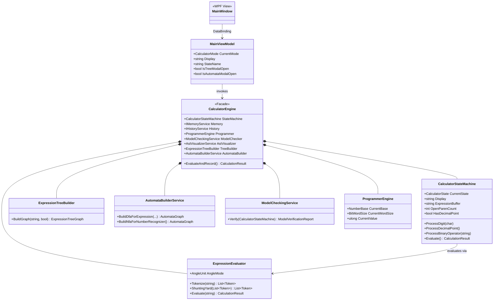
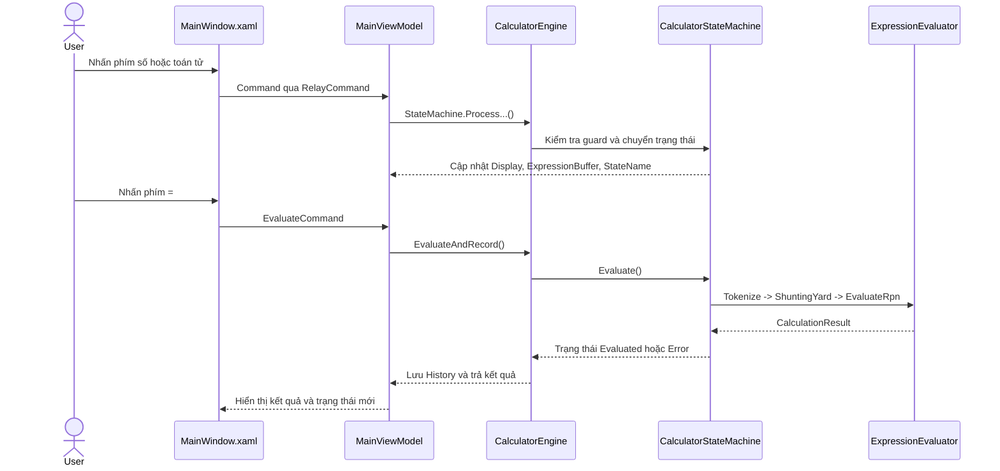

# Báo cáo đồ án nhỏ: Kiểm chứng mô hình CT287

## Chủ đề: Personal Calculator và Bộ trực quan hóa Expression Tree, Automata

---

### Thông tin chung

- Cơ sở đào tạo: Trường Công nghệ Thông tin và Truyền thông – Đại học Cần Thơ, Khoa Công nghệ Phần mềm
- Học phần: Kiểm chứng mô hình CT287
- Ngành: Kỹ thuật Phần mềm
- Giảng viên hướng dẫn: TS. Lâm Hoài Bảo
- Sinh viên thực hiện:
  1. Nguyễn Phước Lộc – MSSV: B2303828
  2. Trần Trọng Phúc – MSSV: B2303844
- Lớp: DI2396A1
- Khóa: 49
- Thời gian thực hiện: Tháng 11/2026

---

## Mục lục

- [1. Tiêu đề](#1-tiêu-đề)
- [2. Tóm tắt](#2-tóm-tắt)
- [3. Đặt vấn đề](#3-đặt-vấn-đề)
- [4. Khái niệm liên quan](#4-khái-niệm-liên-quan)
  - [4.1. FSM, DFA và NFA](#41-fsm-dfa-và-nfa)
  - [4.2. Context-Free Grammar, Shunting-Yard và RPN](#42-context-free-grammar-shunting-yard-và-rpn)
  - [4.3. So sánh Parse Tree và AST](#43-so-sánh-parse-tree-và-ast)
  - [4.4. Model Checking và CTL](#44-model-checking-và-ctl)
  - [4.5. Kiến trúc MVVM trên nền tảng WPF](#45-kiến-trúc-mvvm-trên-nền-tảng-wpf)
- [5. Công việc thực hiện](#5-công-việc-thực-hiện)
  - [5.1. Thiết kế kiến trúc ứng dụng](#51-thiết-kế-kiến-trúc-ứng-dụng)
  - [5.2. Nguyên lý hoạt động của hệ thống](#52-nguyên-lý-hoạt-động-của-hệ-thống)
  - [5.3. Cài đặt chi tiết chương trình và các thành phần cốt lõi](#53-cài-đặt-chi-tiết-chương-trình-và-các-thành-phần-cốt-lõi)
    - [5.3.1. CalculatorStateMachine](#531-calculatorstatemachine)
    - [5.3.2. ExpressionEvaluator](#532-expressionevaluator)
    - [5.3.3. ExpressionTreeBuilder](#533-expressiontreebuilder)
    - [5.3.4. AutomataBuilderService](#534-automatabuilderservice)
    - [5.3.5. ModelCheckingService](#535-modelcheckingservice)
    - [5.3.6. ProgrammerEngine](#536-programmerengine)
    - [5.3.7. Giao diện WPF](#537-giao-diện-wpf)
- [6. Kết luận](#6-kết-luận)
- [7. Kết quả đạt được](#7-kết-quả-đạt-được)
  - [7.1. Kết quả kiểm chứng 7 thuộc tính CTL](#71-kết-quả-kiểm-chứng-7-thuộc-tính-ctl)
  - [7.2. Tổng hợp bộ kiểm thử đơn vị trong Calculator.Tests](#72-tổng-hợp-bộ-kiểm-thử-đơn-vị-trong-calculatortests)
  - [7.3. Bảng kịch bản kiểm thử các ca biên tiêu biểu](#73-bảng-kịch-bản-kiểm-thử-các-ca-biên-tiêu-biểu)
- [8. Tài liệu tham khảo](#8-tài-liệu-tham-khảo)

---

## 1. Tiêu đề

Xây dựng ứng dụng Personal Calculator đa chế độ kết hợp bộ trực quan hóa DFA, NFA, Parse Tree, AST và kiểm chứng thuộc tính CTL trên nền tảng .NET 10 với WPF và MVVM.

---

## 2. Tóm tắt

Báo cáo trình bày chi tiết quá trình thiết kế, cài đặt và kiểm chứng hệ thống Personal Calculator và Expression Tree Visualizer bằng ngôn ngữ C# trên .NET 10 theo kiến trúc MVVM với WPF. Ứng dụng cung cấp đầy đủ 3 chế độ tính toán gồm Standard, Scientific với các hàm lượng giác, logarit, lũy thừa, chuyển đổi `DEG` và `RAD`, cùng Programmer hỗ trợ đồng thời 4 hệ cơ số `HEX`, `DEC`, `OCT`, `BIN` với mặt nạ từ nhớ `Qword`, `Dword`, `Word`, `Byte` và các phép toán bitwise.

Về mặt học thuật của môn Kiểm chứng mô hình CT287, hệ thống mô hình hóa vòng đời nhập liệu của máy tính thành một FSM gồm 8 trạng thái $S_0 \dots S_7$ kèm các guard chặt chẽ nhằm ngăn lỗi nhập sai cú pháp như trùng dấu thập phân hoặc đóng ngoặc khi chưa mở. Kế thừa bài thực hành Session 5 Expression, hệ thống tích hợp modal trực quan hóa cây biểu thức hỗ trợ song song Parse Tree theo ngữ pháp $E \to T \to F$ và AST từ thuật toán Shunting-Yard và RPN, cùng modal trực quan hóa DFA, NFA và dịch vụ `ModelCheckingService` kiểm chứng tự động 7 thuộc tính Safety và Liveness theo CTL. Hệ thống được kiểm thử bằng 8 bộ unit test trên MSTest với tổng cộng 47 phương thức kiểm thử bao phủ từ lõi FSM, parser đến hệ cơ số và kiểm chứng hình thức.

---

## 3. Đặt vấn đề

Một ứng dụng máy tính cá nhân tuy quen thuộc nhưng chứa nhiều trạng thái tương tác phức tạp: người dùng có thể bấm liên tiếp nhiều toán tử, nhập nhiều dấu `.` trong cùng một toán hạng, bấm `)` khi chưa có `(`, nhấn lặp lại phím `=` để lặp phép tính cuối, hoặc thực hiện phép chia cho `0`. Nếu cài đặt bằng các biến cờ rời rạc và rẽ nhánh thủ công, phần mềm dễ rơi vào trạng thái không nhất quán, phát sinh ngoại lệ ngoài ý muốn hoặc cho kết quả sai.

Bên cạnh đó, trong học phần Kiểm chứng mô hình CT287, việc gắn kết trực tiếp lý thuyết về DFA, NFA, Context-Free Grammar, Parse Tree, AST và Model Checking với CTL vào một ứng dụng desktop hoàn chỉnh giúp minh họa rõ ràng cơ chế vận hành của trình phân tích cú pháp và hệ chuyển trạng thái.

Mục tiêu của đồ án:

1. Mô hình hóa chính xác hành vi nhập liệu và tính toán của máy tính cá nhân bằng FSM có lưu vết chuyển tiếp trạng thái.
2. Cài đặt bộ phân tích và định giá biểu thức khoa học bằng Tokenizer, Shunting-Yard và RPN, đồng thời kế thừa thuật toán Recursive Descent Parsing để dựng Parse Tree và AST.
3. Xây dựng công cụ trực quan hóa DFA, NFA, Parse Tree, AST và bộ kiểm chứng tự động 7 thuộc tính Safety và Liveness theo CTL.
4. Hoàn thiện giao diện desktop WPF trên .NET 10 theo kiến trúc MVVM với 3 chế độ Standard, Scientific, Programmer và bộ 47 unit test trên MSTest.

---

## 4. Khái niệm liên quan

### 4.1. FSM, DFA và NFA

FSM là mô hình toán học biểu diễn hệ thống có số lượng trạng thái hữu hạn và chuyển đổi qua lại giữa các trạng thái khi nhận tín hiệu đầu vào. Trong bài toán Personal Calculator, mọi thao tác bấm phím của người dùng đều được xem là một sự kiện kích hoạt chuyển trạng thái trên FSM, giúp loại bỏ việc xử lý rời rạc bằng các biến cờ thủ công.

Một DFA được định nghĩa hình thức bởi bộ 5 thành phần:
$$M = (Q, \Sigma, \delta, q_0, F)$$
Trong đó:

- $Q$: Tập hữu hạn các trạng thái, tương ứng với 8 trạng thái của `CalculatorState` gồm `Start`, `InputOperand`, `OperatorEntered`, `OpenParenEntered`, `CloseParenEntered`, `FunctionEntered`, `Evaluated` và `Error`.
- $\Sigma$: Bảng chữ cái đầu vào gồm chữ số, dấu thập phân, toán tử hai ngôi, dấu ngoặc, hàm khoa học, `=` và `Reset`.
- $\delta: Q \times \Sigma \to Q$: Hàm chuyển trạng thái đơn định. Tại mỗi trạng thái hiện hành và mỗi ký hiệu đầu vào, $\delta$ chỉ dẫn đến tối đa một trạng thái kế tiếp. Trong cài đặt thực tế, hàm $\delta$ được bổ sung các guard để kiểm tra điều kiện hợp lệ trước khi cho phép chuyển tiếp.
- $q_0 \in Q$: Trạng thái khởi đầu duy nhất là `Start`.
- $F \subseteq Q$: Tập trạng thái chấp nhận, đại diện cho trạng thái hoàn tất tính toán `Evaluated`.

Ngược lại, NFA mở rộng mô hình DFA bằng cách cho phép hàm chuyển $\delta: Q \times (\Sigma \cup \{\epsilon\}) \to \mathcal{P}(Q)$ có thể rẽ ra nhiều trạng thái đích hoặc thực hiện $\epsilon$-transition mà không cần tiêu thụ ký tự đầu vào. Trong đồ án, DFA được dùng để mô tả luồng điều khiển và chuỗi token của phép tính hiện hành, còn NFA được dùng để minh họa quá trình Lexer Tokenizer nhận dạng hằng số thực với phần nguyên, dấu `.` và phần thập phân tùy chọn.

| Tiêu chí               | DFA                                                     | NFA                                                       |
| :--------------------- | :------------------------------------------------------ | :-------------------------------------------------------- |
| Tính đơn định          | Mỗi cặp $(q, a)$ chỉ có duy nhất một trạng thái kế tiếp | Một cặp $(q, a)$ có thể dẫn tới nhiều trạng thái kế tiếp  |
| Chuyển tiếp $\epsilon$ | Không cho phép                                          | Cho phép $\epsilon$-transition                            |
| Độ phức tạp thực thi   | Thời gian duyệt tuyến tính $O(n)$ theo độ dài chuỗi     | Cần theo dõi tập trạng thái hoặc chuyển đổi sang DFA      |
| Ứng dụng trong đồ án   | Mô hình hóa FSM máy tính và đồ thị biểu thức hiện hành  | Minh họa quá trình nhận dạng hằng số thực trong Tokenizer |

### 4.2. Context-Free Grammar, Shunting-Yard và RPN

Context-Free Grammar được định nghĩa bởi bộ 4 thành phần $G = (V, \Sigma, R, S)$, trong đó $V$ là tập Non-terminal, $\Sigma$ là tập Terminal, $R$ là tập luật sinh có dạng $A \to \alpha$ với $A \in V$ và $\alpha \in (V \cup \Sigma)^*$, còn $S \in V$ là ký hiệu bắt đầu. Trong bài toán biểu thức số học, $V = \{E, T, F\}$ đại diện cho Expression, Term và Factor; $\Sigma$ gồm các toán tử, dấu ngoặc và giá trị số `id`.

Kế thừa từ bài thực hành Session 5 Expression, bộ dựng Parse Tree sử dụng Context-Free Grammar dạng EBNF:
$$E \to T \{ (+ \mid -) T \}^* \qquad T \to F \{ (* \mid /) F \}^* \qquad F \to (E) \mid \text{id}$$
Cấu trúc 3 tầng này giải quyết đồng thời hai yêu cầu cốt lõi của trình phân tích cú pháp:

1. Bảo toàn Precedence: Luật sinh nằm ở tầng sâu hơn có độ ưu tiên cao hơn ($F > T > E$). Nhờ vậy, phép nhân và chia tại tầng $T$ luôn được tính trước phép cộng và trừ tại tầng $E$, còn biểu thức con trong ngoặc `(E)` tại tầng $F$ luôn được giải quyết trước tiên.
2. Bảo toàn Left-associativity và tránh đệ quy vô hạn: Nếu viết đệ quy trái trực tiếp như $E \to E - T$, hàm Recursive Descent Parsing sẽ tự gọi lại chính nó trước khi dịch con trỏ chuỗi và dẫn tới tràn ngăn xếp. Việc viết lại dưới dạng lặp $\{ (+ \mid -) T \}^*$ cho phép cài đặt bằng vòng lặp `while` giữ nguyên tính kết hợp trái cho phép trừ và phép chia, như $(10 - 4) - 2 = 4$ và $(20 / 4) / 2 = 2.5$.

Song song với Recursive Descent Parsing, bộ tính toán lõi `ExpressionEvaluator` sử dụng thuật toán Shunting-Yard để chuyển biểu thức Infix sang Postfix ở dạng RPN thông qua `operatorStack` và `outputQueue`:

- Khi gặp toán hạng hoặc hằng số, đưa trực tiếp vào `outputQueue`.
- Khi gặp hàm hoặc `(`, đẩy vào `operatorStack`.
- Khi gặp toán tử hai ngôi, lần lượt lấy các toán tử trên đỉnh `operatorStack` đưa ra `outputQueue` nếu toán tử trên đỉnh có precedence cao hơn, hoặc có precedence bằng nhau và toán tử hiện tại có Left-associativity, sau đó mới đẩy toán tử hiện tại vào ngăn xếp.
- Khi gặp `)`, đẩy các toán tử ra `outputQueue` cho đến khi gặp `(` tương ứng và loại bỏ cặp ngoặc này.
- Khi hết chuỗi đầu vào, đẩy toàn bộ toán tử còn lại trong `operatorStack` sang `outputQueue`.

Ví dụ với biểu thức `2 * 3 + 6`, thuật toán Shunting-Yard thu được chuỗi RPN là `2 3 * 6 +`. Nhờ không còn dấu ngoặc và đã sắp xếp đúng thứ tự thực thi, RPN cho phép tính giá trị biểu thức chỉ trong một lượt duyệt ngăn xếp và dựng trực tiếp AST.

### 4.3. So sánh Parse Tree và AST

Cả Parse Tree và AST đều biểu diễn cấu trúc phân cấp của biểu thức toán học nhưng phục vụ hai mục đích khác nhau trong xử lý ngôn ngữ:

| Tiêu chí       | Parse Tree                                                          | AST                                                               |
| :------------- | :------------------------------------------------------------------ | :---------------------------------------------------------------- |
| Nguồn sinh     | Bộ phân tích `RecursiveDescentParser` theo ngữ pháp $E \to T \to F$ | Chuỗi RPN từ thuật toán Shunting-Yard                             |
| Thành phần nút | Gồm các Non-terminal $E, T, F$, ngoặc `(`, `)`, toán tử và số       | Lược bỏ $E, T, F$ và cặp ngoặc, chỉ giữ toán tử, hàm và toán hạng |
| Cấu trúc cây   | Nhiều tầng và nhiều nút trung gian                                  | Gọn nhẹ, phản ánh trực tiếp thứ tự thực thi phép tính             |
| Vai trò        | Minh họa quá trình suy dẫn văn phạm hình thức                       | Biểu diễn cấu trúc toán học tối ưu cho tính toán                  |

Với cùng biểu thức `2 * 3 + 6`, Parse Tree sẽ có các nút gốc `E` phân nhánh xuống `T`, `F`, toán tử `*`, `+` và các nút lá số; trong khi AST chỉ giữ 5 nút gồm nút gốc `+`, nhánh trái `*` với hai con `2`, `3`, và nhánh phải `6`.

### 4.4. Model Checking và CTL

Model Checking là phương pháp kiểm chứng hình thức nhằm xác minh tự động xem một mô hình hệ thống hữu hạn trạng thái có thỏa mãn các đặc tả tính chất cho trước hay không. Hệ thống được mô hình hóa như một Kripke Structure gồm tập trạng thái, quan hệ chuyển tiếp và hàm gán nhãn thuộc tính tại mỗi trạng thái.

CTL là ngôn ngữ logic thời gian dạng cây cho phép phát biểu các yêu cầu trên toàn bộ cây tính toán xuất phát từ trạng thái hiện tại, sử dụng cặp lượng từ đường đi và toán tử thời gian:

- $A$ và $E$: $A$ biểu thị tính chất đúng trên mọi đường đi thực thi, còn $E$ biểu thị tồn tại ít nhất một đường đi thỏa mãn tính chất.
- $G$, $F$ và $X$: $G$ biểu thị luôn đúng tại mọi trạng thái dọc theo đường đi, $F$ biểu thị sẽ đạt tới tại một trạng thái trong tương lai, và $X$ biểu thị đúng tại trạng thái kế tiếp ngay sau đó.

Hai nhóm thuộc tính quan trọng được kiểm chứng trong đồ án:

- Safety ở dạng $AG(\neg \text{Bad})$: khẳng định trạng thái lỗi hoặc bất hợp lệ không bao giờ xuất hiện trên mọi đường đi, tiêu biểu như số ngoặc mở chưa đóng luôn không âm, mỗi toán hạng có tối đa một dấu thập phân và phép chia cho `0` không gây crash.
- Liveness ở dạng $AG(EF(\text{Good}))$ hoặc $AG(\text{Cond} \Rightarrow EX(\text{Target}))$: khẳng định hệ thống luôn có hướng tiến triển hợp lệ, tiêu biểu như Deadlock Freedom trên cả 8 trạng thái, khả năng quay về `Start` qua `Reset` và khả năng đạt tới `Evaluated` khi biểu thức hợp lệ.

### 4.5. Kiến trúc MVVM trên nền tảng WPF

MVVM là mẫu kiến trúc chuẩn cho các ứng dụng desktop WPF, tách mã nguồn thành 3 tầng có trách nhiệm độc lập:

- Model: Toàn bộ logic nghiệp vụ, FSM, parser, các service trực quan hóa và kiểm chứng nằm trong `Calculator.Core` dưới dạng thư viện .NET độc lập hoàn toàn với giao diện.
- ViewModel: Lớp `MainViewModel` kế thừa `ViewModelBase` triển khai `INotifyPropertyChanged`, giữ các thuộc tính hiển thị như `Display`, `ExpressionDisplay`, `StateName` và tiếp nhận tương tác người dùng thông qua `ICommand` với `RelayCommand`.
- View: Tệp `MainWindow.xaml` định nghĩa bố cục giao diện bằng XAML và liên kết hai chiều tới `MainViewModel` thông qua Data Binding, không chứa logic tính toán nghiệp vụ. Nhờ sự tách biệt này, toàn bộ 47 unit test trong `Calculator.Tests` có thể kiểm thử trực tiếp trên `Calculator.Core` mà không cần khởi chạy giao diện WPF.

---

## 5. Công việc thực hiện

### 5.1. Thiết kế kiến trúc ứng dụng

Solution `Calculator.slnx` được tổ chức thành 3 project độc lập cùng thư mục tài liệu:

```text
05_Calculator/
├── Calculator.slnx
├── README.md
├── start.bat
├── start.ps1
├── docs/
│   └── report.md
├── Calculator.Core/
│   ├── Enums/CalculatorEnums.cs
│   ├── Models/CalculatorModels.cs
│   ├── StateMachine/CalculatorStateMachine.cs
│   ├── Parser/ExpressionEvaluator.cs
│   └── Services/
│       ├── CalculatorEngine.cs
│       ├── ExpressionTreeBuilder.cs
│       ├── AutomataBuilderService.cs
│       ├── ModelCheckingService.cs
│       ├── AstVisualizerService.cs
│       ├── ProgrammerEngine.cs
│       ├── MemoryService.cs
│       ├── HistoryService.cs
│       └── TraceExporter.cs
├── Calculator.UI/
│   ├── App.xaml
│   ├── App.xaml.cs
│   ├── Common/
│   │   ├── RelayCommand.cs
│   │   └── ViewModelBase.cs
│   ├── ViewModels/MainViewModel.cs
│   └── Views/MainWindow.xaml
└── Calculator.Tests/
    ├── AutomataTests.cs
    ├── CalculatorEngineTests.cs
    ├── ExpressionEvaluatorTests.cs
    ├── ExpressionTreeBuilderTests.cs
    ├── MemoryAndHistoryTests.cs
    ├── ModelCheckingAndAstTests.cs
    ├── ProgrammerEngineTests.cs
    └── StateMachineTests.cs
```

Sơ đồ lớp tổng thể của hệ thống:



[Chèn hình 1 - Figure 1: Cấu trúc solution Calculator.slnx và giao diện tổng quan của ứng dụng khi khởi chạy]

---

### 5.2. Nguyên lý hoạt động của hệ thống

Luồng xử lý một phép tính trong chế độ Standard hoặc Scientific diễn ra theo các bước sau:

1. Tiếp nhận tương tác UI: Người dùng bấm nút trên `MainWindow.xaml` hoặc nhập từ bàn phím. Lệnh được chuyển qua `RelayCommand` đến `MainViewModel`.
2. Chuyển tiếp trạng thái trên FSM: `MainViewModel` gọi phương thức tương ứng trên `CalculatorEngine.StateMachine` như `ProcessDigit`, `ProcessBinaryOperator`, `ProcessOpenParen`, `ProcessCloseParen` hoặc `ProcessFunction`. Các guard kiểm tra tính hợp lệ, cập nhật `Display`, `ExpressionBuffer`, chuyển `CurrentState` và ghi bản ghi `StateTransitionRecord` vào `TransitionLog`.
3. Định giá biểu thức khi bấm `=`: `MainViewModel` gọi `CalculatorEngine.EvaluateAndRecord()`. Phương thức `CalculatorStateMachine.Evaluate()` ghép `ExpressionBuffer` với `Display`, tự động cân bằng ngoặc còn mở nếu cần hoặc hỗ trợ bấm `=` lặp lại qua `_lastOperator` và `_lastOperand`, sau đó gọi `ExpressionEvaluator` thực thi `Tokenize`, `ShuntingYard` và `EvaluateRpn`.
4. Xử lý kết quả và lưu lịch sử: Nếu biểu thức hợp lệ, FSM chuyển sang `Evaluated`, định dạng kết quả qua `CalculationResult.FormatNumber` và lưu vào `HistoryService`. Nếu gặp lỗi như chia cho `0` hoặc sai miền giá trị, FSM chuyển an toàn sang `Error`.
5. Trực quan hóa theo yêu cầu: Khi mở modal cây biểu thức, `ExpressionTreeBuilder.BuildGraph()` dựng Parse Tree hoặc AST kèm tọa độ $(X, Y)$ để vẽ lên Canvas. Khi mở modal ôtomat, `AutomataBuilderService` sinh đồ thị DFA cho biểu thức hiện hành hoặc NFA nhận dạng số thực và làm sáng trạng thái đang hoạt động.



---

### 5.3. Cài đặt chi tiết chương trình và các thành phần cốt lõi

#### 5.3.1. CalculatorStateMachine

Trong `CalculatorEnums.cs` và `CalculatorStateMachine.cs`, máy tính được mô hình hóa thành 8 trạng thái:

| Mã trạng thái | Giá trị `CalculatorState` | Ý nghĩa                                                                         |
| :-----------: | :------------------------ | :------------------------------------------------------------------------------ |
|     $S_0$     | `Start`                   | Trạng thái khởi tạo ban đầu với `Display` bằng `"0"` và `ExpressionBuffer` rỗng |
|     $S_1$     | `InputOperand`            | Đang nhập chữ số hoặc dấu thập phân, giới hạn tối đa 45 chữ số                  |
|     $S_2$     | `OperatorEntered`         | Vừa nhập toán tử hai ngôi như `+`, `-`, `*`, `/`, `^`, `mod`                    |
|     $S_3$     | `OpenParenEntered`        | Vừa nhập dấu mở ngoặc `(`                                                       |
|     $S_4$     | `CloseParenEntered`       | Vừa nhập dấu đóng ngoặc `)`                                                     |
|     $S_5$     | `FunctionEntered`         | Vừa gọi một hàm khoa học như `sin`, `cos`, `sqrt`                               |
|     $S_6$     | `Evaluated`               | Đã tính xong kết quả sau khi nhấn `=`                                           |
|     $S_7$     | `Error`                   | Trạng thái lỗi an toàn khi chia cho `0` hoặc lỗi miền giá trị                   |

Các cơ chế kiểm soát chính trong `CalculatorStateMachine`:

- Chống trùng dấu thập phân: thuộc tính `CanEnterDecimalPoint` kiểm tra `!HasDecimalPoint && CurrentState != CalculatorState.CloseParenEntered` để từ chối dấu `.` thứ hai trong cùng một toán hạng.
- Cân bằng ngoặc: thuộc tính `CanEnterCloseParen` chỉ cho phép nhập `)` khi `OpenParenCount > 0` và `CurrentState` đang ở `InputOperand` hoặc `CloseParenEntered`.
- Implicit Multiplication: khi đang ở trạng thái `CloseParenEntered` và người dùng bấm chữ số hoặc dấu `.`, FSM tự động chèn `" * "` vào `ExpressionBuffer`.
- Nhật ký chuyển tiếp `TransitionLog`: mỗi bước chuyển tiếp lưu `StepIndex`, `FromState`, `InputType`, `InputValue`, `ToState`, `DisplaySnapshot` và `ExpressionSnapshot`.

[Chèn hình 2 - Figure 2: Giao diện Standard Mode hiển thị phép tính, kết quả và trạng thái FSM trên thanh tiêu đề]

#### 5.3.2. ExpressionEvaluator

Tệp `ExpressionEvaluator.cs` cài đặt quy trình định giá biểu thức qua 3 bước:

1. `Tokenize(string expr)`: chuẩn hóa các ký hiệu giao diện (`×` thành `*`, `÷` thành `/`, `−` thành `-`, `π` thành `pi`, `√` thành `sqrt`), tách số nguyên và số thực, hằng số `pi` và `e`, danh sách hàm khoa học (`sin`, `cos`, `tan`, `sec`, `csc`, `cot`, `asin`, `acos`, `atan`, `sinh`, `cosh`, `tanh`, `log`, `ln`, `log10`, `log2`, `sqrt`, `cbrt`, `abs`, `exp`, `sqr`, `cube`, `recip`, `fact`, `floor`, `ceil`), dấu ngoặc và toán tử.
2. `ShuntingYard(List<Token> tokens)`: sắp xếp lại token theo precedence và associativity để tạo danh sách token dạng RPN.
3. `EvaluateRpn(List<Token> rpn)`: duyệt chuỗi RPN trên ngăn xếp giá trị, áp dụng `AngleMode` theo `Degree` hoặc `Radian`, bắt các ngoại lệ `DivideByZeroException`, `ArgumentException`, `InvalidOperationException` và trả về `CalculationResult.Fail(...)`.

[Chèn hình 3 - Figure 3: Giao diện Scientific Mode cùng menu Trigonometry, Function và nút chuyển DEG/RAD]

#### 5.3.3. ExpressionTreeBuilder

Tệp `ExpressionTreeBuilder.cs` cung cấp phương thức `BuildGraph(string expression, bool fullParseTree)` phục vụ modal cây biểu thức:

- Khi `fullParseTree = true`: sử dụng `RecursiveDescentParser` phân giải theo ngữ pháp $E \to T \to F$ để tạo đầy đủ các nút `Expression`, `Term`, `Factor`, `Operator`, `Parenthesis` và `Number`.
- Khi `fullParseTree = false`: gọi `BuildAstFromRpn(rpnTokens)` để dựng cây AST rút gọn từ chuỗi RPN.
- Phương thức `ComputeLayout` tính tọa độ $(X, Y)$ cân đối giữa các nhánh con, tự mở rộng `CanvasWidth` và `CanvasHeight`, đồng thời gán màu riêng cho từng `ExpressionTreeNodeType`.

[Chèn hình 4 - Figure 4: Modal Expression Tree ở chế độ Parse Tree cùng chuỗi RPN ở footer]

[Chèn hình 5 - Figure 5: Modal Expression Tree ở chế độ AST cho cùng biểu thức]

#### 5.3.4. AutomataBuilderService

Tệp `AutomataBuilderService.cs` dựng 2 sơ đồ cho modal ôtomat:

- `BuildDfaForExpression`: sinh đồ thị DFA tương ứng với biểu thức hiện hành trên máy tính, bắt đầu từ `S0: START`, đi qua từng trạng thái `S1..Sn` ứng với mỗi token, kết thúc tại nút vòng đôi `SEVAL: [result]` khi gặp `=` kèm cung tự lặp cho phép nhấn `=` liên tiếp.
- `BuildNfaForNumberRecognizer`: dựng mô hình NFA minh họa quá trình nhận dạng hằng số thực với phần nguyên, dấu `.` và phần thập phân.

[Chèn hình 6 - Figure 6: Modal Automata Visualizer ở tab DFA cho phép tính hiện hành]

[Chèn hình 7 - Figure 7: Modal Automata Visualizer ở tab NFA nhận dạng số thực]

#### 5.3.5. ModelCheckingService

Tệp `ModelCheckingService.cs` cài đặt phương thức `Verify(CalculatorStateMachine fsm)` để kiểm chứng 7 thuộc tính Safety và Liveness theo CTL và xuất `ModelVerificationReport`:

| Mã        | Tên thuộc tính                             |   Nhóm   | Công thức CTL                                                                                                                     | Cách kiểm chứng trong mã nguồn                                                                                 |
| :-------- | :----------------------------------------- | :------: | :-------------------------------------------------------------------------------------------------------------------------------- | :------------------------------------------------------------------------------------------------------------- |
| `PROP-01` | Parenthesis Non-Negativity Invariant       |  Safety  | $AG(\text{OpenParenCount} \ge 0)$                                                                                                 | Kiểm tra `OpenParenCount >= 0` và xác nhận `ProcessCloseParen()` trả về `false` khi bộ đếm bằng `0`            |
| `PROP-02` | Single Decimal Point per Operand Invariant |  Safety  | $AG(\text{HasDecimalPoint} \land \text{Input} = '.' \Rightarrow \text{RejectTransition})$                                         | Nhập `'5'`, thử `ProcessDecimalPoint()` lần 1 (nhận) và lần 2 (từ chối), kiểm tra `Display == "5."`            |
| `PROP-03` | Zero Division Crash Freedom                |  Safety  | $AG(\text{DivByZero} \Rightarrow \text{State} = S_{\text{Error}} \land \neg\text{Crash})$                                         | Thực thi `9 / 0 =`, xác nhận `Evaluate()` trả về `!IsSuccess` và chuyển sang `CalculatorState.Error`           |
| `PROP-04` | Initial State Invariant Consistency        |  Safety  | $AG(\text{State} = S_{\text{Start}} \Rightarrow \text{Display} = '0' \land \text{Expression} = \emptyset \land \text{Paren} = 0)$ | Khởi tạo FSM mới và kiểm tra đồng thời 4 điều kiện bất biến ban đầu                                            |
| `PROP-05` | Deadlock Freedom                           | Liveness | $AG(\forall s \in Q: \exists a \in \Sigma, \delta(s, a) \in Q)$                                                                   | Dựng đủ cả 8 trạng thái của `CalculatorState`, xác nhận trạng thái đạt được và có chuyển tiếp `Reset()` hợp lệ |
| `PROP-06` | Reset Reachability                         | Liveness | $AG(EF(\text{State} = S_{\text{Start}}))$                                                                                         | Từ tất cả 8 trạng thái $S_0 \dots S_7$, gọi `Reset()` và kiểm tra đều quay về `CalculatorState.Start`          |
| `PROP-07` | Evaluation Reachability                    | Liveness | $AG(\text{ValidCompleteInput} \land \text{Input} = '=' \Rightarrow EX(\text{State} = S_{\text{Evaluated}}))$                      | Chạy phép tính `12 + 8 =`, xác nhận chuyển tới `CalculatorState.Evaluated` với `Display == "20"`               |

#### 5.3.6. ProgrammerEngine

Tệp `ProgrammerEngine.cs` xử lý tính toán số nguyên `ulong` cho chế độ Programmer:

- Chuyển đổi đồng thời giá trị hiện tại sang 4 hệ cơ số `HEX`, `DEC`, `OCT`, `BIN`.
- Áp dụng mặt nạ `Mask` theo 4 kích thước từ nhớ `Qword`, `Dword`, `Word`, `Byte`.
- Lọc bảng chữ cái đầu vào $\Sigma_{\text{base}}$ trên UI để vô hiệu hóa các phím chữ số không thuộc hệ cơ số đang chọn.
- Hỗ trợ các phép toán số học và bitwise gồm `AND`, `OR`, `XOR`, `NOT`, `Lsh`, `Rsh`, `Mod`.

[Chèn hình 8 - Figure 8: Giao diện Programmer Mode hiển thị đồng thời HEX, DEC, OCT, BIN và trạng thái khóa phím theo cơ số]

#### 5.3.7. Giao diện WPF

Giao diện WPF trong `MainViewModel.cs` và `MainWindow.xaml` sử dụng tông màu `#1f5ca9`, tích hợp Dynamic Font Downsizing giảm dần `DisplayFontSize` từ `46` xuống `12` khi chuỗi số dài tới 45 chữ số, cùng Drawer Menu chuyển chế độ, History Drawer và Memory Drawer (`MC`, `MR`, `M+`, `M-`, `MS`).

---

## 6. Kết luận

Đồ án đã hoàn thiện ứng dụng Personal Calculator đa chế độ kết hợp bộ trực quan hóa Automata và Expression Tree đáp ứng đầy đủ cả yêu cầu thực tiễn lẫn nội dung lý thuyết của học phần Kiểm chứng mô hình CT287:

- Mô hình hóa hành vi nhập liệu và tính toán bằng FSM 8 trạng thái kèm guard chặt chẽ, ngăn chặn triệt để các lỗi cú pháp và ngoại lệ chia cho `0`.
- Kế thừa và mở rộng bài thực hành Session 5 Expression để hỗ trợ song song Parse Tree theo ngữ pháp $E \to T \to F$ và AST từ Shunting-Yard và RPN.
- Tích hợp trực quan hóa DFA, NFA và bộ kiểm chứng tự động 7 thuộc tính Safety và Liveness theo CTL.
- Tách biệt hoàn toàn lõi tính toán `Calculator.Core` khỏi giao diện WPF `Calculator.UI` theo mô hình MVVM, tạo điều kiện thuận lợi cho việc kiểm thử đơn vị và mở rộng về sau.

---

## 7. Kết quả đạt được

### 7.1. Kết quả kiểm chứng 7 thuộc tính CTL

Dịch vụ `ModelCheckingService` thực thi kiểm chứng đồng thời 4 thuộc tính Safety (`PROP-01` đến `PROP-04`) và 3 thuộc tính Liveness (`PROP-05` đến `PROP-07`), xác nhận không có trạng thái đóng ngoặc âm, không có toán hạng chứa nhiều dấu thập phân, phép chia cho `0` không làm sập ứng dụng, không tồn tại trạng thái deadlock trong 8 trạng thái $S_0 \dots S_7$ và mọi trạng thái đều có thể quay về `Start` qua `Reset()`.

### 7.2. Tổng hợp bộ kiểm thử đơn vị trong `Calculator.Tests`

Dự án `Calculator.Tests` gồm 8 tệp kiểm thử MSTest với tổng cộng 47 `[TestMethod]`:

| STT | Tệp kiểm thử                    | Số lượng test | Phạm vi kiểm tra chính                                                                                             |
| :-: | :------------------------------ | :-----------: | :----------------------------------------------------------------------------------------------------------------- |
|  1  | `StateMachineTests.cs`          |      12       | 8 trạng thái FSM, chống trùng dấu `.`, cân bằng ngoặc, implicit multiplication, lặp `=`, nhập số lớn hơn 40 chữ số |
|  2  | `ExpressionEvaluatorTests.cs`   |      10       | Tokenizer, Shunting-Yard, precedence, ngoặc lồng nhau, hàm khoa học, `DEG` và `RAD`, chia cho 0                    |
|  3  | `ProgrammerEngineTests.cs`      |       7       | Chuyển đổi `HEX`, `DEC`, `OCT`, `BIN`, mặt nạ `Qword`, `Dword`, `Word`, `Byte`, phép toán bitwise                  |
|  4  | `ExpressionTreeBuilderTests.cs` |       5       | Dựng Parse Tree, dựng AST, tọa độ 2D Canvas, chuỗi RPN                                                             |
|  5  | `ModelCheckingAndAstTests.cs`   |       5       | Kiểm chứng 7 thuộc tính CTL trong `ModelCheckingService` và trace Shunting-Yard trong `AstVisualizerService`       |
|  6  | `AutomataTests.cs`              |       3       | Dựng đồ thị DFA cho biểu thức và NFA nhận dạng số thực                                                             |
|  7  | `CalculatorEngineTests.cs`      |       3       | Kiểm thử tích hợp qua Facade `CalculatorEngine`                                                                    |
|  8  | `MemoryAndHistoryTests.cs`      |       2       | Quản lý thanh nhớ và lịch sử phép tính                                                                             |
|     | Tổng cộng                       |      47       | Phủ toàn bộ lõi tính toán, FSM, Parser, Automata, CTL và Programmer                                                |

[Chèn hình 9 - Figure 9: Kết quả chạy lệnh `dotnet test Calculator.Tests/Calculator.Tests.csproj` trên terminal hoặc Test Explorer]

### 7.3. Bảng kịch bản kiểm thử các ca biên tiêu biểu

| Kịch bản kiểm thử       | Thao tác đầu vào               | Kết quả mong đợi và hành vi hệ thống                                                                    |
| :---------------------- | :----------------------------- | :------------------------------------------------------------------------------------------------------ |
| Chống trùng dấu chấm    | Nhập `5`, `.`, `.`             | Chỉ nhận `5.`; lần bấm `.` thứ hai bị `CanEnterDecimalPoint` từ chối                                    |
| Cân bằng ngoặc          | Nhập `)` ngay tại `Start`      | Bị `CanEnterCloseParen` chặn vì `OpenParenCount == 0`                                                   |
| Implicit Multiplication | Nhập `(2 + 3)` rồi bấm `4`     | Tự động chèn `*` thành `(2 + 3) * 4` và trả về `20`                                                     |
| Chia cho 0              | Nhập `10 / 0 =`                | Chuyển an toàn sang trạng thái $S_7$ `Error`, hiển thị thông báo lỗi                                    |
| Nhập số lớn             | Nhập liên tiếp trên 25 chữ số  | `DisplayFontSize` tự động thu nhỏ từ `46` xuống `12–15`, không tràn khung                               |
| Parse Tree và AST       | Nhập `2 * 3 + 6`, mở modal cây | Parse Tree dựng cây $E \to T \to F$; AST dựng cây `+` $\to$ (`*` $\to$ `2, 3`, `6`); RPN là `2 3 * 6 +` |
| Programmer Base Filter  | Chọn hệ `BIN`                  | Chỉ bật phím `0` và `1`; vô hiệu hóa các phím `2..9` và `A..F`                                          |

---

## 8. Tài liệu tham khảo

1. Tài liệu học phần Kiểm chứng mô hình CT287 – Khoa Công nghệ Thông tin và Truyền thông, Trường Đại học Cần Thơ.
2. Bài thực hành Session 5 Expression trong `CT287_Labs/03_Expression`.
3. Baier, C., & Katoen, J.-P. (2008). Principles of Model Checking. MIT Press.
4. Dijkstra, E. W. (1961). Algol 60 Translation. Mathematisch Centrum, Amsterdam.
5. Microsoft Learn. .NET 10 và WPF Documentation.
