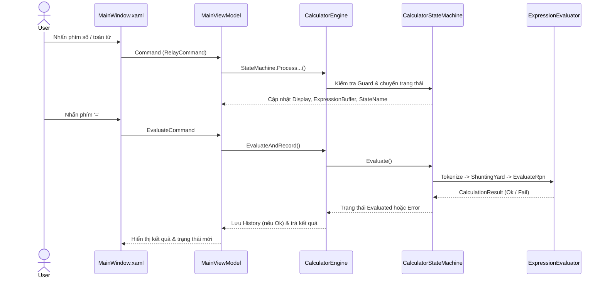

# BÁO CÁO ĐỒ ÁN NHỎ: KIỂM CHỨNG MÔ HÌNH (CT287)

## CHỦ ĐỀ: MÁY TÍNH CÁ NHÂN & BỘ TRỰC QUAN HÓA CÂY BIỂU THỨC, Ô-TÔ-MÁT (PERSONAL CALCULATOR & MODEL CHECKING VISUALIZER)

---

### THÔNG TIN CHUNG

- **Cơ sở đào tạo:** Trường Công nghệ Thông tin & Truyền thông – Đại học Cần Thơ (Khoa Công nghệ Phần mềm)
- **Học phần:** Kiểm chứng mô hình (CT287)
- **Ngành:** Kỹ thuật Phần mềm
- **Giảng viên hướng dẫn:** TS. Lâm Hoài Bảo
- **Sinh viên thực hiện:**
  1. **Nguyễn Phước Lộc** – MSSV: **B2303828**
  2. **Trần Trọng Phúc** – MSSV: **B2303844**
- **Lớp:** DI2396A1
- **Khóa:** 49
- **Thời gian thực hiện:** Tháng 11/2026

---

## MỤC LỤC

- [1. Tiêu đề](#1-tiêu-đề)
- [2. Tóm tắt](#2-tóm-tắt)
- [3. Đặt vấn đề](#3-đặt-vấn-đề)
- [4. Khái niệm liên quan](#4-khái-niệm-liên-quan)
  - [4.1. Ô-tô-mát hữu hạn trạng thái (FSM, DFA và NFA)](#41-ô-tô-mát-hữu-hạn-trạng-thái-fsm-dfa-và-nfa)
  - [4.2. Văn phạm phi ngữ cảnh (CFG), Shunting-Yard và RPN](#42-văn-phạm-phi-ngữ-cảnh-cfg-shunting-yard-và-rpn)
  - [4.3. So sánh Parse Tree ($E \to T \to F$) và Abstract Syntax Tree (AST)](#43-so-sánh-parse-tree-e-to-t-to-f-và-abstract-syntax-tree-ast)
  - [4.4. Kiểm chứng mô hình (Model Checking) và Logic CTL](#44-kiểm-chứng-mô-hình-model-checking-và-logic-ctl)
  - [4.5. Kiến trúc MVVM trên nền tảng WPF (.NET 10)](#45-kiến-trúc-mvvm-trên-nền-tảng-wpf-net-10)
- [5. Công việc thực hiện](#5-công-việc-thực-hiện)
  - [5.1. Thiết kế kiến trúc ứng dụng](#51-thiết-kế-kiến-trúc-ứng-dụng)
  - [5.2. Nguyên lý hoạt động của hệ thống](#52-nguyên-lý-hoạt-động-của-hệ-thống)
  - [5.3. Cài đặt chi tiết chương trình và các thành phần cốt lõi](#53-cài-đặt-chi-tiết-chương-trình-và-các-thành-phần-cốt-lõi)
    - [5.3.1. Máy hữu hạn trạng thái `CalculatorStateMachine`](#531-máy-hữu-hạn-trạng-thái-calculatorstatemachine)
    - [5.3.2. Bộ phân tích và tính toán biểu thức `ExpressionEvaluator`](#532-bộ-phân-tích-và-tính-toán-biểu-thức-expressionevaluator)
    - [5.3.3. Bộ trực quan hóa Cây biểu thức `ExpressionTreeBuilder`](#533-bộ-trực-quan-hóa-cây-biểu-thức-expressiontreebuilder)
    - [5.3.4. Bộ trực quan hóa Ô-tô-mát `AutomataBuilderService`](#534-bộ-trực-quan-hóa-ô-tô-mát-automatabuilderservice)
    - [5.3.5. Dịch vụ Kiểm chứng mô hình `ModelCheckingService`](#535-dịch-vụ-kiểm-chứng-mô-hình-modelcheckingservice)
    - [5.3.6. Chế độ Lập trình viên `ProgrammerEngine`](#536-chế-độ-lập-trình-viên-programmerengine)
    - [5.3.7. Giao diện người dùng WPF (`Calculator.UI`) và Slide thuyết trình](#537-giao-diện-người-dùng-wpf-calculatorui-và-slide-thuyết-trình)
- [6. Kết luận](#6-kết-luận)
- [7. Kết quả đạt được](#7-kết-quả-đạt-được)
  - [7.1. Kết quả kiểm chứng 7 tính chất CTL](#71-kết-quả-kiểm-chứng-7-tính-chất-ctl)
  - [7.2. Tổng hợp bộ kiểm thử đơn vị (`Calculator.Tests`)](#72-tổng-hợp-bộ-kiểm-thử-đơn-vị-calculatortests)
  - [7.3. Bảng kịch bản kiểm thử các ca biên tiêu biểu](#73-bảng-kịch-bản-kiểm-thử-các-ca-biên-tiêu-biểu)
- [8. Tài liệu tham khảo](#8-tài-liệu-tham-khảo)

---

## 1. Tiêu đề

Xây dựng ứng dụng Máy tính cá nhân đa chế độ kết hợp Bộ trực quan hóa Ô-tô-mát (DFA/NFA), Cây biểu thức (Parse Tree / AST) và Kiểm chứng tính chất CTL trên nền tảng .NET 10 (WPF + MVVM).

---

## 2. Tóm tắt

Báo cáo trình bày chi tiết quá trình thiết kế, cài đặt và kiểm chứng hệ thống **Máy tính cá nhân & Bộ trực quan hóa Cây Biểu Thức (Personal Calculator & Expression Tree Visualizer)** bằng ngôn ngữ **C# (.NET 10)** theo kiến trúc **MVVM** trên nền tảng **WPF**. Ứng dụng cung cấp đầy đủ 3 chế độ tính toán thực tiễn gồm **Standard** (chuẩn 4×6), **Scientific** (khoa học 5×7 với hàm lượng giác, logarit, lũy thừa, chuyển đổi `DEG`/`RAD`) và **Programmer** (lập trình viên 6×6 hỗ trợ đồng thời 4 hệ cơ số `HEX`, `DEC`, `OCT`, `BIN` cùng mặt nạ từ nhớ 64/32/16/8-bit và phép toán bitwise).

Về mặt học thuật môn **Kiểm chứng mô hình (CT287)**, hệ thống mô hình hóa toàn bộ vòng đời nhập liệu của máy tính thành một **Máy hữu hạn trạng thái (FSM)** gồm 8 trạng thái ($S_0 \dots S_7$) với các điều kiện rào chắn (*guards*) chặt chẽ nhằm ngăn lỗi nhập sai cú pháp như trùng dấu thập phân hoặc đóng ngoặc khi chưa mở. Kế thừa bài thực hành **Session 5 - Expression**, hệ thống tích hợp **Modal Trực quan hóa Cây biểu thức** hỗ trợ song song cả **Parse Tree** ($E \to T \to F$) và **AST Tree** (từ thuật toán Shunting-Yard / RPN), cùng **Modal Trực quan hóa Ô-tô-mát (DFA & NFA)** và dịch vụ **ModelCheckingService** kiểm chứng tự động 7 thuộc tính *Safety* và *Liveness* theo logic **CTL**. Hệ thống được kiểm thử bằng 8 bộ kiểm thử đơn vị MSTest với tổng cộng **47 phương thức kiểm thử** bao phủ từ lõi FSM, phân tích biểu thức đến hệ cơ số và kiểm chứng hình thức.

---

## 3. Đặt vấn đề

Một ứng dụng máy tính cá nhân tưởng chừng đơn giản nhưng lại chứa nhiều trạng thái tương tác phức tạp: người dùng có thể bấm liên tiếp nhiều dấu toán tử, nhập nhiều dấu `.` trong cùng một số, bấm `)` khi chưa có `(`, nhấn lặp lại phím `=` để lặp phép tính cuối, hoặc chia cho `0`. Nếu cài đặt bằng các biến cờ rời rạc và rẽ nhánh `if-else` tự phát, phần mềm rất dễ rơi vào trạng thái không nhất quán, treo ứng dụng hoặc cho kết quả sai.

Bên cạnh đó, trong học phần **Kiểm chứng mô hình (CT287)**, việc kết nối trực tiếp lý thuyết về **Ô-tô-mát hữu hạn (DFA/NFA)**, **Văn phạm phi ngữ cảnh (CFG)**, **Cây phân giải cú pháp** và **Kiểm chứng thuộc tính CTL** vào một sản phẩm desktop hoàn chỉnh giúp minh họa trực quan cơ chế hoạt động bên trong của bộ biên dịch và hệ chuyển trạng thái.

Mục tiêu của đồ án:
1. Mô hình hóa chính xác hành vi nhập liệu và tính toán của máy tính cá nhân bằng **Máy hữu hạn trạng thái (FSM)** có ghi vết chuyển tiếp trạng thái.
2. Cài đặt bộ phân tích và định giá biểu thức khoa học bằng **Tokenizer + Shunting-Yard (RPN)**, đồng thời kế thừa thuật toán đệ quy xuống từ bài trước để dựng **Parse Tree** và **AST**.
3. Xây dựng công cụ trực quan hóa **DFA/NFA**, **Parse Tree/AST** và bộ kiểm chứng tự động **7 thuộc tính Safety & Liveness (CTL)**.
4. Hoàn thiện giao diện desktop **WPF (.NET 10)** theo kiến trúc **MVVM** với 3 chế độ (*Standard, Scientific, Programmer*) và bộ **47 Unit Tests** trên MSTest.

---

## 4. Khái niệm liên quan

### 4.1. Ô-tô-mát hữu hạn trạng thái (FSM, DFA và NFA)

Một Ô-tô-mát hữu hạn xác định (**DFA**) được định nghĩa hình thức bởi bộ 5 thành phần:
$$M = (Q, \Sigma, \delta, q_0, F)$$
Trong đó:
- $Q$: Tập hữu hạn các trạng thái (trong đồ án là 8 trạng thái của `CalculatorState`).
- $\Sigma$: Bảng chữ cái đầu vào (chữ số, dấu chấm, toán tử, dấu ngoặc, hàm khoa học, `=`, `Reset`).
- $\delta: Q \times \Sigma \to Q$: Hàm chuyển trạng thái đơn định, tích hợp các điều kiện kiểm soát (*guard*) trước khi chuyển tiếp.
- $q_0 \in Q$: Trạng thái khởi đầu (`Start`).
- $F \subseteq Q$: Tập trạng thái chấp nhận (`Evaluated`).

Trong khi đó, Ô-tô-mát hữu hạn không xác định (**NFA**) cho phép chuyển tiếp $\epsilon$ và nhiều nhánh chuyển trên cùng một ký tự, được đồ án dùng để minh họa quá trình **Lexer Tokenizer** nhận dạng hằng số thực (`[0-9]+(\.[0-9]+)?`).

### 4.2. Văn phạm phi ngữ cảnh (CFG), Shunting-Yard và RPN

- **Văn phạm phi ngữ cảnh mở rộng (CFG V2):** Kế thừa từ bài thực hành `Session 5 - Expression`, bộ dựng Parse Tree sử dụng văn phạm phân tầng bảo toàn thứ tự ưu tiên và tính kết hợp trái:
  $$E \to T \{ (+ \mid -) T \}^* \qquad T \to F \{ (* \mid /) F \}^* \qquad F \to (E) \mid \text{id}$$
- **Thuật toán Shunting-Yard & RPN:** Do Edsger Dijkstra đề xuất, chuyển biểu thức trung tố (*Infix*, ví dụ `2 + 3 * 4`) thành hậu tố (*Postfix / Reverse Polish Notation - RPN*, ví dụ `2 3 4 * +`) bằng một ngăn xếp toán tử (`operatorStack`) và một hàng đợi đầu ra (`outputQueue`). Nhờ có độ ưu tiên (*Precedence*) và tính kết hợp (*Associativity* — ví dụ lũy thừa `^` kết hợp phải, `+ - * /` kết hợp trái), RPN cho phép tính giá trị biểu thức chỉ trong một lượt quét ngăn xếp và dựng trực tiếp cây AST.

### 4.3. So sánh Parse Tree ($E \to T \to F$) và Abstract Syntax Tree (AST)

| Tiêu chí | Parse Tree (Cây phân giải đầy đủ) | AST (Cây cú pháp trừu tượng) |
| :--- | :--- | :--- |
| **Nguồn gốc** | Sinh bởi bộ phân tích đệ quy xuống (`RecursiveDescentParser`) | Sinh từ chuỗi hậu tố RPN của thuật toán Shunting-Yard |
| **Thành phần nút** | Gồm cả ký hiệu chưa kết thúc ($E, T, F$), ngoặc `(`, `)`, toán tử và số | Lược bỏ $E, T, F$ và cặp ngoặc; chỉ giữ toán tử, hàm và toán hạng |
| **Kích thước cây** | Nhiều tầng và nhiều nút trung gian | Gọn nhẹ, phản ánh trực tiếp thứ tự thực thi phép tính |
| **Mục đích sử dụng** | Minh họa quá trình suy dẫn văn phạm hình thức | Tối ưu cho việc tính toán giá trị và biểu diễn cấu trúc toán học |

### 4.4. Kiểm chứng mô hình (Model Checking) và Logic CTL

Kiểm chứng mô hình biểu diễn hệ thống dưới dạng hệ chuyển trạng thái và kiểm tra xem các đặc tả hình thức viết bằng **Logic cây tính toán (Computation Tree Logic – CTL)** có luôn đúng trên các đường đi thực thi hay không:
- **Tính chất An toàn (*Safety* — dạng $AG(\neg \text{Bad})$):** Đảm bảo "điều xấu không bao giờ xảy ra", ví dụ số ngoặc mở chưa đóng luôn không âm ($AG(\text{OpenParenCount} \ge 0)$), chia cho 0 không làm sập ứng dụng.
- **Tính chất Hoạt tính (*Liveness* — dạng $AG(EF(\text{Good}))$):** Đảm bảo "điều tốt cuối cùng sẽ đạt được", ví dụ mọi trạng thái đều không bị kẹt (*Deadlock Freedom*) và luôn quay về được trạng thái khởi đầu `Start` khi bấm `Reset`.

### 4.5. Kiến trúc MVVM trên nền tảng WPF (.NET 10)

Mẫu **Model – View – ViewModel (MVVM)** tách biệt hoàn toàn giao diện XAML (`Views`) khỏi logic điều khiển (`ViewModels`) và nghiệp vụ lõi (`Calculator.Core`):
- **Model:** Các dịch vụ và mô hình dữ liệu trong `Calculator.Core`.
- **ViewModel (`MainViewModel`):** Lưu trạng thái hiển thị, thực thi `ICommand` qua `RelayCommand` và thông báo cập nhật UI qua `INotifyPropertyChanged`.
- **View (`MainWindow.xaml`):** Ràng buộc dữ liệu (*Data Binding*) hai chiều tới ViewModel, không chứa logic tính toán nghiệp vụ.

---

## 5. Công việc thực hiện

### 5.1. Thiết kế kiến trúc ứng dụng

Solution `Calculator.slnx` được tổ chức thành 3 project độc lập cùng thư mục slide thuyết trình và tài liệu:

```text
05_Calculator/
├── Calculator.slnx                           # Solution .NET 10
├── README.md                                 # Tài liệu hướng dẫn tổng quan
├── start.bat & start.ps1                     # Script khởi chạy ứng dụng WPF
├── start-presentation.bat                    # Script mở nhanh bộ slide HTML
├── docs/
│   └── report.md                             # Báo cáo chi tiết đồ án (file này)
├── presentation/                             # Bộ 10 slide thuyết trình HTML/CSS/JS
│   ├── index.html
│   ├── style.css
│   └── presentation.js
├── Calculator.Core/                          # Thư viện logic thuần (net10.0)
│   ├── Enums/CalculatorEnums.cs              # CalculatorState, CalculatorMode, NumberBase, BitWordSize...
│   ├── Models/CalculatorModels.cs            # Token, CalculationResult, StateTransitionRecord, AST/Tree, CTL models
│   ├── StateMachine/CalculatorStateMachine.cs# FSM 8 trạng thái & kiểm soát nhập liệu
│   ├── Parser/ExpressionEvaluator.cs         # Tokenizer, Shunting-Yard, RPN Evaluator
│   └── Services/
│       ├── CalculatorEngine.cs               # Facade điều phối toàn bộ hệ thống
│       ├── ExpressionTreeBuilder.cs          # Dựng Parse Tree (E->T->F) và AST kèm tọa độ 2D
│       ├── AutomataBuilderService.cs         # Dựng đồ thị DFA biểu thức & NFA số thực
│       ├── ModelCheckingService.cs           # Kiểm chứng 7 tính chất Safety/Liveness (CTL)
│       ├── AstVisualizerService.cs           # Sinh trace từng bước của Shunting-Yard
│       ├── ProgrammerEngine.cs               # Xử lý 4 cơ số (HEX/DEC/OCT/BIN) & Bitwise
│       ├── MemoryService.cs                  # Quản lý thanh nhớ MC, MR, M+, M-, MS
│       ├── HistoryService.cs                 # Quản lý lịch sử phép tính
│       └── TraceExporter.cs                  # Xuất vết thực thi
├── Calculator.UI/                            # Giao diện Desktop WPF (.NET 10-windows)
│   ├── App.xaml & App.xaml.cs                # Theme Dark Sapphire Blue (#1f5ca9)
│   ├── Common/                               # ViewModelBase, RelayCommand
│   ├── ViewModels/MainViewModel.cs           # ViewModel điều khiển 3 chế độ & 2 Modals
│   └── Views/MainWindow.xaml                 # Cửa sổ chính, bàn phím 3 chế độ & Canvas đồ thị
└── Calculator.Tests/                         # Bộ kiểm thử đơn vị MSTest (47 TestMethods)
    ├── AutomataTests.cs
    ├── CalculatorEngineTests.cs
    ├── ExpressionEvaluatorTests.cs
    ├── ExpressionTreeBuilderTests.cs
    ├── MemoryAndHistoryTests.cs
    ├── ModelCheckingAndAstTests.cs
    ├── ProgrammerEngineTests.cs
    └── StateMachineTests.cs
```

#### Sơ đồ lớp tổng thể (Class Diagram)


> **[CHÈN HÌNH 1 — Figure 1: Sơ đồ cấu trúc Solution `Calculator.slnx` trong Visual Studio / VS Code và tổng quan ứng dụng khi khởi chạy]**

---

### 5.2. Nguyên lý hoạt động của hệ thống

Luồng xử lý một phép tính tiêu biểu (ở chế độ *Standard* hoặc *Scientific*) diễn ra khép kín qua các bước sau:

1. **Tiếp nhận tương tác UI:** Người dùng bấm nút trên `MainWindow.xaml` (hoặc gõ bàn phím). Lệnh được chuyển qua `RelayCommand` tới `MainViewModel`.
2. **Chuyển tiếp trạng thái trên FSM:** `MainViewModel` gọi phương thức tương ứng trên `CalculatorEngine.StateMachine` (ví dụ `ProcessDigit`, `ProcessBinaryOperator`, `ProcessOpenParen`, `ProcessCloseParen`, `ProcessFunction`). Tại đây, các guard kiểm tra tính hợp lệ; nếu hợp lệ sẽ cập nhật `Display`, `ExpressionBuffer`, chuyển `CurrentState` và ghi một bản ghi `StateTransitionRecord` vào `TransitionLog`.
3. **Định giá biểu thức khi bấm `=`:** `MainViewModel` gọi `CalculatorEngine.EvaluateAndRecord()`. `CalculatorStateMachine.Evaluate()` ghép `ExpressionBuffer + Display`, tự động đóng các dấu ngoặc còn mở (nếu có) hoặc hỗ trợ bấm `=` lặp lại (`_lastOperator`, `_lastOperand`), rồi giao cho `ExpressionEvaluator` thực hiện `Tokenize` $\rightarrow$ `ShuntingYard` $\rightarrow$ `EvaluateRpn`.
4. **Xử lý kết quả & ghi lịch sử:** Nếu thành công, FSM chuyển sang `Evaluated`, định dạng số sạch qua `CalculationResult.FormatNumber` và lưu vào `HistoryService`. Nếu có ngoại lệ (như chia cho `0`, căn bậc hai số âm, lỗi cú pháp), FSM chuyển an toàn sang trạng thái `Error` mà không làm sập ứng dụng.
5. **Trực quan hóa theo yêu cầu:**
   - Khi mở **Expression Tree Modal**, `ExpressionTreeBuilder.BuildGraph()` dựng **Parse Tree** hoặc **AST** kèm tọa độ $(X, Y)$ để `MainWindow.xaml` vẽ lên `Canvas`.
   - Khi mở **Automata Modal**, `AutomataBuilderService` sinh đồ thị **DFA** tương ứng biểu thức hiện hành hoặc **NFA** nhận dạng số thực, đồng thời làm sáng (*highlight*) trạng thái đang hoạt động.



---

### 5.3. Cài đặt chi tiết chương trình và các thành phần cốt lõi

#### 5.3.1. Máy hữu hạn trạng thái `CalculatorStateMachine`

Trong [`CalculatorEnums.cs`](file:///d:/DU%20LIEU/CTU/Kiem%20chung%20mo%20hinh/Th%C6%B0c%20hanh/CT287_Labs/05_Calculator/Calculator.Core/Enums/CalculatorEnums.cs) và [`CalculatorStateMachine.cs`](file:///d:/DU%20LIEU/CTU/Kiem%20chung%20mo%20hinh/Th%C6%B0c%20hanh/CT287_Labs/05_Calculator/Calculator.Core/StateMachine/CalculatorStateMachine.cs), máy tính được mô hình hóa thành **8 trạng thái**:

| Mã trạng thái | Enum (`CalculatorState`) | Ý nghĩa |
| :---: | :--- | :--- |
| $S_0$ | `Start` | Trạng thái khởi tạo ban đầu (`Display = "0"`, `ExpressionBuffer = ""`) |
| $S_1$ | `InputOperand` | Đang nhập chữ số hoặc dấu thập phân (cho phép tối đa **45 chữ số**) |
| $S_2$ | `OperatorEntered` | Vừa nhập toán tử hai ngôi (`+`, `-`, `*`, `/`, `^`, `mod`...) |
| $S_3$ | `OpenParenEntered` | Vừa nhập dấu mở ngoặc `(` |
| $S_4$ | `CloseParenEntered` | Vừa nhập dấu đóng ngoặc `)` |
| $S_5$ | `FunctionEntered` | Vừa gọi hàm khoa học (`sin`, `cos`, `sqrt`, ...) |
| $S_6$ | `Evaluated` | Đã tính xong kết quả sau khi nhấn `=` (trạng thái chấp nhận) |
| $S_7$ | `Error` | Trạng thái lỗi an toàn khi chia cho `0` hoặc lỗi miền giá trị |

Các cơ chế kiểm soát quan trọng đã cài đặt trong FSM:
- **Chống trùng dấu thập phân:** Thuộc tính `CanEnterDecimalPoint` (`!HasDecimalPoint && CurrentState != CloseParenEntered`) từ chối mọi lần bấm `.` thứ hai trong cùng một toán hạng.
- **Cân bằng ngoặc:** `CanEnterCloseParen` chỉ cho phép nhập `)` khi `OpenParenCount > 0` và đang ở trạng thái `InputOperand` hoặc `CloseParenEntered`.
- **Nhân ngầm (*Implicit Multiplication*):** Khi đang ở `CloseParenEntered` mà người dùng bấm số hoặc `.`, FSM tự động chèn `" * "` vào `ExpressionBuffer` (ví dụ `) 5` thành `) * 5`).
- **Nhật ký chuyển tiếp (`TransitionLog`):** Mỗi bước chuyển đều lưu `StepIndex`, `FromState`, `InputType`, `InputValue`, `ToState`, `DisplaySnapshot` và `ExpressionSnapshot` phục vụ kiểm chứng và truy vết.

> **[CHÈN HÌNH 2 — Figure 2: Giao diện Standard Mode hiển thị biểu thức tính toán, kết quả và nhãn trạng thái FSM ở góc trên]**

#### 5.3.2. Bộ phân tích và tính toán biểu thức `ExpressionEvaluator`

Tệp [`ExpressionEvaluator.cs`](file:///d:/DU%20LIEU/CTU/Kiem%20chung%20mo%20hinh/Th%C6%B0c%20hanh/CT287_Labs/05_Calculator/Calculator.Core/Parser/ExpressionEvaluator.cs) cài đặt quy trình tính toán chuẩn gồm 3 giai đoạn:
1. **`Tokenize(string expr)`:** Chuẩn hóa ký hiệu giao diện (`×` $\to$ `*`, `÷` $\to$ `/`, `−` $\to$ `-`, `π` $\to$ `pi`, `√` $\to$ `sqrt`), nhận dạng số nguyên/thực, hằng số (`pi`, `e`), hàm toán học (`sin`, `cos`, `tan`, `sec`, `csc`, `cot`, `asin`, `acos`, `atan`, `sinh`, `cosh`, `tanh`, `log`, `ln`, `log10`, `log2`, `sqrt`, `cbrt`, `abs`, `exp`, `sqr`, `cube`, `recip`, `fact`, `floor`, `ceil`), dấu ngoặc và toán tử một ngôi/hai ngôi.
2. **`ShuntingYard(List<Token> tokens)`:** Đẩy toán hạng vào hàng đợi đầu ra, xử lý độ ưu tiên và tính kết hợp trên ngăn xếp toán tử để thu được danh sách token theo thứ tự hậu tố RPN.
3. **`EvaluateRpn(List<Token> rpn)`:** Duyệt chuỗi RPN bằng ngăn xếp giá trị, hỗ trợ chuyển đổi đơn vị góc `AngleMode` (`Degree` / `Radian`) và bắt các ngoại lệ `DivideByZeroException`, `ArgumentException`, `InvalidOperationException` để trả về `CalculationResult.Fail(...)` kèm thông báo rõ ràng.

> **[CHÈN HÌNH 3 — Figure 3: Giao diện Scientific Mode với đầy đủ hàm lượng giác (`Trigonometry`), hàm toán học (`Function`) và nút chuyển `DEG`/`RAD`]**

#### 5.3.3. Bộ trực quan hóa Cây biểu thức `ExpressionTreeBuilder`

Tệp [`ExpressionTreeBuilder.cs`](file:///d:/DU%20LIEU/CTU/Kiem%20chung%20mo%20hinh/Th%C6%B0c%20hanh/CT287_Labs/05_Calculator/Calculator.Core/Services/ExpressionTreeBuilder.cs) cung cấp phương thức `BuildGraph(string expression, bool fullParseTree)` phục vụ Modal Cây biểu thức:
- **Chế độ Parse Tree (`fullParseTree = true`):** Dùng lớp nội bộ `RecursiveDescentParser` phân giải đệ quy xuống theo văn phạm V2 ($E \to T \to F$), tạo đầy đủ các nút `Expression` ($E$), `Term` ($T$), `Factor` ($F$), `Operator`, `Parenthesis` và `Number`.
- **Chế độ AST (`fullParseTree = false`):** Gọi `BuildAstFromRpn(rpnTokens)` để dựng cây nhị phân/đơn ngôi gọn nhẹ trực tiếp từ kết quả Shunting-Yard.
- **Tự động bố cục 2D (`ComputeLayout`):** Tính tọa độ `(X, Y)` cân đối giữa các cây con, tự động mở rộng `CanvasWidth` / `CanvasHeight` và tô màu phân biệt theo `ExpressionTreeNodeType` (`Expression` `#0B3954`, `Term` `#087E8B`, `Factor` `#3C1B58`, `Operator` `#1f5ca9`, `Number` `#1A2234`, `Function` `#065F46`).

> **[CHÈN HÌNH 4 — Figure 4: Modal Expression Tree đang hiển thị chế độ Parse Tree ($E \to T \to F$) cùng chuỗi RPN ở footer]**
>
> **[CHÈN HÌNH 5 — Figure 5: Modal Expression Tree đang hiển thị chế độ AST Tree rút gọn cho cùng biểu thức]**

#### 5.3.4. Bộ trực quan hóa Ô-tô-mát `AutomataBuilderService`

Tệp [`AutomataBuilderService.cs`](file:///d:/DU%20LIEU/CTU/Kiem%20chung%20mo%20hinh/Th%C6%B0c%20hanh/CT287_Labs/05_Calculator/Calculator.Core/Services/AutomataBuilderService.cs) dựng 2 loại sơ đồ đồ thị cho Modal Automata:
1. **Tab DFA (`BuildDfaForExpression`):** Tự động sinh đồ thị DFA tương ứng với biểu thức đang tính trên máy tính — bắt đầu từ `S0: START`, đi qua lần lượt từng trạng thái `S1..Sn` ứng với mỗi token, kết thúc tại trạng thái chấp nhận vòng đôi `SEVAL: [result]` khi gặp `=`, kèm cung tự lặp cho phép bấm `=` liên tiếp.
2. **Tab NFA (`BuildNfaForNumberRecognizer`):** Minh họa mô hình Ô-tô-mát hữu hạn không xác định nhận dạng hằng số số thực (hỗ trợ phần nguyên, dấu chấm thập phân và phần thập phân).

> **[CHÈN HÌNH 6 — Figure 6: Modal Automata Visualizer — Tab DFA minh họa chuỗi trạng thái của phép tính hiện hành]**
>
> **[CHÈN HÌNH 7 — Figure 7: Modal Automata Visualizer — Tab NFA nhận dạng hằng số số thực]**

#### 5.3.5. Dịch vụ Kiểm chứng mô hình `ModelCheckingService`

Tệp [`ModelCheckingService.cs`](file:///d:/DU%20LIEU/CTU/Kiem%20chung%20mo%20hinh/Th%C6%B0c%20hanh/CT287_Labs/05_Calculator/Calculator.Core/Services/ModelCheckingService.cs) cài đặt phương thức `Verify(CalculatorStateMachine fsm)` để tự động kiểm tra **7 thuộc tính hình thức** (4 thuộc tính *Safety* và 3 thuộc tính *Liveness*) và xuất báo cáo `ModelVerificationReport`:

| Mã | Tên thuộc tính | Loại | Công thức CTL | Cơ chế kiểm chứng |
| :--- | :--- | :---: | :--- | :--- |
| `PROP-01` | Parenthesis Non-Negativity Invariant | Safety | $AG(\text{OpenParenCount} \ge 0)$ | Kiểm tra `OpenParenCount >= 0` và xác nhận `ProcessCloseParen()` bị chặn khi bằng `0` |
| `PROP-02` | Single Decimal Point per Operand | Safety | $AG(\text{HasDecimalPoint} \land \text{Input} = '.' \Rightarrow \text{Reject})$ | Thử nhập `'5'`, `'.'` lần 1 (nhận) và `'.'` lần 2 (bị guard từ chối) |
| `PROP-03` | Zero Division Crash Freedom | Safety | $AG(\text{DivByZero} \Rightarrow \text{State} = S_{\text{Error}} \land \neg\text{Crash})$ | Thực thi `9 / 0 =`, xác nhận chuyển về `CalculatorState.Error` không ném ngoại lệ ra ngoài |
| `PROP-04` | Initial State Invariant Consistency | Safety | $AG(\text{State} = S_{\text{Start}} \Rightarrow \text{Display} = '0' \land \text{Paren} = 0)$ | Khởi tạo FSM mới, kiểm tra đồng thời `CurrentState`, `Display`, `OpenParenCount` và `ExpressionBuffer` |
| `PROP-05` | Deadlock Freedom | Liveness | $AG(\forall s \in Q: \exists a \in \Sigma, \delta(s, a) \in Q)$ | Dựng đủ cả 8 trạng thái $S_0 \dots S_7$, xác nhận mọi trạng thái đều có chuyển tiếp hợp lệ |
| `PROP-06` | Reset Reachability | Liveness | $AG(EF(\text{State} = S_{\text{Start}}))$ | Từ tất cả 8 trạng thái $S_0 \dots S_7$, gọi `Reset()` và kiểm tra đều quay về `Start` |
| `PROP-07` | Evaluation Reachability | Liveness | $AG(\text{ValidCompleteInput} \land \text{Input} = '=' \Rightarrow EX(\text{State} = S_{\text{Evaluated}}))$ | Chạy `12 + 8 =`, xác nhận chuyển tới `Evaluated` với `Display == "20"` |

#### 5.3.6. Chế độ Lập trình viên `ProgrammerEngine`

Tệp [`ProgrammerEngine.cs`](file:///d:/DU%20LIEU/CTU/Kiem%20chung%20mo%20hinh/Th%C6%B0c%20hanh/CT287_Labs/05_Calculator/Calculator.Core/Services/ProgrammerEngine.cs) xử lý tính toán số nguyên không dấu `ulong` theo chuẩn lập trình viên:
- Chuyển đổi tức thời giá trị sang 4 hệ cơ số: **HEX** (16), **DEC** (10), **OCT** (8), **BIN** (2).
- Áp dụng mặt nạ từ nhớ (`Mask`) theo 4 kích thước: **Qword** (64-bit), **Dword** (32-bit), **Word** (16-bit), **Byte** (8-bit).
- Lọc bảng chữ cái đầu vào động ($\Sigma_{\text{base}}$): giao diện tự động vô hiệu hóa các phím chữ số không hợp lệ với cơ số đang chọn (ví dụ ở `BIN` chỉ bật `0`, `1`; ở `OCT` bật `0..7`; ở `HEX` bật thêm `A..F`).
- Hỗ trợ các phép toán số học và bitwise (`AND`, `OR`, `XOR`, `NOT`, `Lsh`, `Rsh`, `Mod`).

> **[CHÈN HÌNH 8 — Figure 8: Giao diện Programmer Mode hiển thị đồng thời 4 hệ cơ số HEX/DEC/OCT/BIN và trạng thái bật/tắt phím theo hệ cơ số]**

#### 5.3.7. Giao diện người dùng WPF (`Calculator.UI`) và Slide thuyết trình

- **Giao diện WPF ([`MainViewModel.cs`](file:///d:/DU%20LIEU/CTU/Kiem%20chung%20mo%20hinh/Th%C6%B0c%20hanh/CT287_Labs/05_Calculator/Calculator.UI/ViewModels/MainViewModel.cs) & `MainWindow.xaml`):** Thiết kế theo phong cách Dark Mode với màu nhấn Sapphire Blue `#1f5ca9`. Hỗ trợ **Dynamic Font Downsizing** tự động giảm cỡ chữ `DisplayFontSize` từ `46` xuống `12` khi chuỗi số dài tới 45 chữ số; tích hợp Drawer Menu chuyển chế độ, History Drawer phục hồi phép tính cũ và Memory Drawer (`MC`, `MR`, `M+`, `M-`, `MS`).
- **Bộ Slide thuyết trình ([`presentation/index.html`](file:///d:/DU%20LIEU/CTU/Kiem%20chung%20mo%20hinh/Th%C6%B0c%20hanh/CT287_Labs/05_Calculator/presentation/index.html)):** Gồm 10 slide HTML/CSS/JS thuần hiệu ứng lướt ngang, hỗ trợ điều khiển bàn phím, vuốt chạm và toàn màn hình, mở nhanh bằng `start-presentation.bat`.

> **[CHÈN HÌNH 9 — Figure 9: Giao diện bộ Slide thuyết trình HTML (`presentation/index.html`)]**

---

## 6. Kết luận

Đồ án **Máy tính cá nhân & Bộ trực quan hóa Cây Biểu Thức / Ô-tô-mát** đã hoàn thành đầy đủ các yêu cầu cả về mặt ứng dụng thực tiễn lẫn nội dung học thuật của học phần **Kiểm chứng mô hình (CT287)**:
- Mô hình hóa chặt chẽ hành vi của máy tính cá nhân bằng **FSM 8 trạng thái**, loại bỏ hoàn toàn các lỗi nhập liệu không hợp lệ và lỗi chia cho `0`.
- Kế thừa và mở rộng thành công bài thực hành **Session 5 - Expression**, kết hợp được cả **Parse Tree ($E \to T \to F$)** lẫn **AST Tree (Shunting-Yard)** trên cùng một giao diện trực quan.
- Tích hợp công cụ trực quan hóa **DFA/NFA** và bộ kiểm chứng tự động **7 thuộc tính Safety & Liveness (CTL)** ngay trong lõi ứng dụng.
- Tách biệt sạch sẽ tầng logic (`Calculator.Core`) khỏi giao diện WPF (`Calculator.UI`) theo mô hình **MVVM**, giúp dễ dàng kiểm thử tự động và bảo trì mở rộng.

---

## 7. Kết quả đạt được

### 7.1. Kết quả kiểm chứng 7 tính chất CTL

Dịch vụ `ModelCheckingService` kiểm chứng đồng thời 4 tính chất *Safety* (`PROP-01` đến `PROP-04`) và 3 tính chất *Liveness* (`PROP-05` đến `PROP-07`), đảm bảo:
- Không tồn tại trạng thái đóng ngoặc âm hoặc dư thừa dấu thập phân trong một toán hạng.
- Mọi phép chia cho `0` đều chuyển về trạng thái `Error` một cách an toàn.
- Cả 8 trạng thái $S_0 \dots S_7$ đều đạt tới được (*reachable*), không có trạng thái kẹt (*deadlock*) và luôn quay về được `Start` khi `Reset`.

### 7.2. Tổng hợp bộ kiểm thử đơn vị (`Calculator.Tests`)

Dự án [`Calculator.Tests`](file:///d:/DU%20LIEU/CTU/Kiem%20chung%20mo%20hinh/Th%C6%B0c%20hanh/CT287_Labs/05_Calculator/Calculator.Tests/Calculator.Tests.csproj) bao gồm **8 tệp kiểm thử MSTest** với tổng cộng **47 phương thức kiểm thử (`[TestMethod]`)**:

| STT | Tệp kiểm thử | Số lượng Test | Phạm vi kiểm tra chính |
| :---: | :--- | :---: | :--- |
| 1 | `StateMachineTests.cs` | 12 | 8 trạng thái FSM, chống 2 dấu `.`, cân bằng ngoặc, nhân ngầm, lặp `=`, nhập số lớn 40+ chữ số |
| 2 | `ExpressionEvaluatorTests.cs` | 10 | Tokenizer, Shunting-Yard, ưu tiên toán tử, ngoặc lồng nhau, hàm khoa học, `DEG`/`RAD`, chia 0 |
| 3 | `ProgrammerEngineTests.cs` | 7 | Chuyển đổi `HEX`/`DEC`/`OCT`/`BIN`, mặt nạ `Qword`/`Dword`/`Word`/`Byte`, phép toán bitwise |
| 4 | `ExpressionTreeBuilderTests.cs` | 5 | Dựng Parse Tree ($E \to T \to F$), dựng AST, tọa độ 2D Canvas, chuỗi RPN |
| 5 | `ModelCheckingAndAstTests.cs` | 5 | Kiểm chứng 7 thuộc tính CTL (`ModelCheckingService`) và trace Shunting-Yard (`AstVisualizerService`) |
| 6 | `AutomataTests.cs` | 3 | Sinh đồ thị DFA biểu thức hiện hành và NFA nhận dạng số thực |
| 7 | `CalculatorEngineTests.cs` | 3 | Kiểm thử tích hợp toàn chu trình tính toán qua Facade `CalculatorEngine` |
| 8 | `MemoryAndHistoryTests.cs` | 2 | Thanh nhớ (`MC`, `MR`, `M+`, `M-`, `MS`) và lịch sử phép tính (`HistoryService`) |
| | **Tổng cộng** | **47** | **Phủ toàn bộ lõi tính toán, FSM, Parser, Automata, CTL và Programmer** |

> **[CHÈN HÌNH 10 — Figure 10: Kết quả chạy lệnh `dotnet test Calculator.Tests/Calculator.Tests.csproj` (hoặc Test Explorer trong Visual Studio)]**

### 7.3. Bảng kịch bản kiểm thử các ca biên tiêu biểu

| Kịch bản kiểm thử | Đầu vào / Thao tác | Kết quả mong đợi & Hành vi hệ thống |
| :--- | :--- | :--- |
| **Chống trùng dấu chấm** | Nhập `5`, `.`, `.` | Chỉ nhận `5.`; lần bấm `.` thứ hai bị guard `CanEnterDecimalPoint` từ chối |
| **Cân bằng ngoặc** | Nhập `)` ngay ở trạng thái `Start` | Bị guard `CanEnterCloseParen` chặn vì `OpenParenCount == 0` |
| **Nhân ngầm sau ngoặc** | Nhập `(2 + 3)` rồi bấm `4` | Tự động chèn `*` thành `(2 + 3) * 4`, tính ra `20` |
| **Chia cho 0** | Nhập `10 / 0 =` | Chuyển an toàn sang trạng thái $S_7$ (`Error`), hiển thị thông báo lỗi, không crash |
| **Nhập số lớn** | Nhập liên tiếp > 25 chữ số | `DisplayFontSize` tự động thu nhỏ từ `46` xuống `12–15`, không tràn khung hiển thị |
| **Parse Tree vs AST** | Nhập `2 * 3 + 6`, mở Tree Modal | Parse Tree dựng cây $E \to T \to F$; AST dựng cây gọn `+` $\to$ (`*` $\to$ `2, 3`, `6`); RPN: `2 3 * 6 +` |
| **Programmer Base Filter** | Chọn hệ `BIN` | Chỉ cho phép bấm `0` và `1`; các phím `2..9` và `A..F` bị vô hiệu hóa |

---

## 8. Tài liệu tham khảo

1. Tài liệu học phần **Kiểm chứng mô hình (CT287)** – Khoa Công nghệ Thông tin & Truyền thông, Trường Đại học Cần Thơ.
2. Bài thực hành **Session 5 – Expression** (`CT287_Labs/03_Expression`): Văn phạm phi ngữ cảnh và thuật toán phân tích cú pháp đệ quy xuống.
3. Baier, C., & Katoen, J.-P. (2008). *Principles of Model Checking*. MIT Press.
4. Dijkstra, E. W. (1961). *Algol 60 Translation* (Thuật toán Shunting-Yard). Mathematisch Centrum, Amsterdam.
5. Microsoft Learn. *.NET 10 & Windows Presentation Foundation (WPF) Documentation — MVVM Pattern*.
